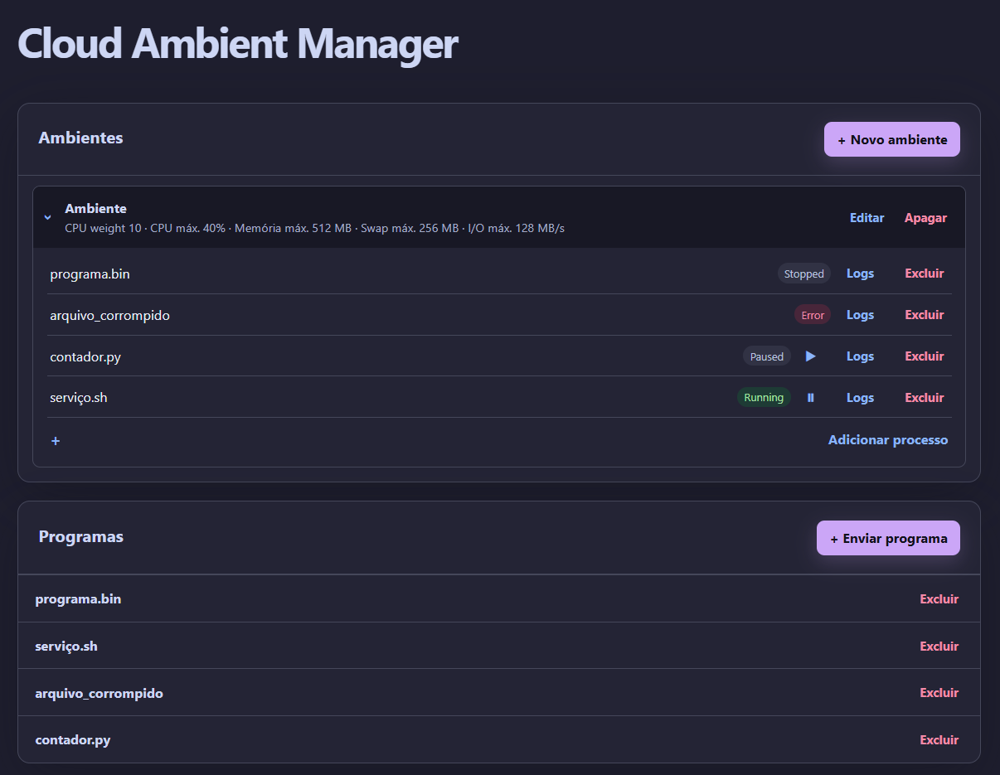
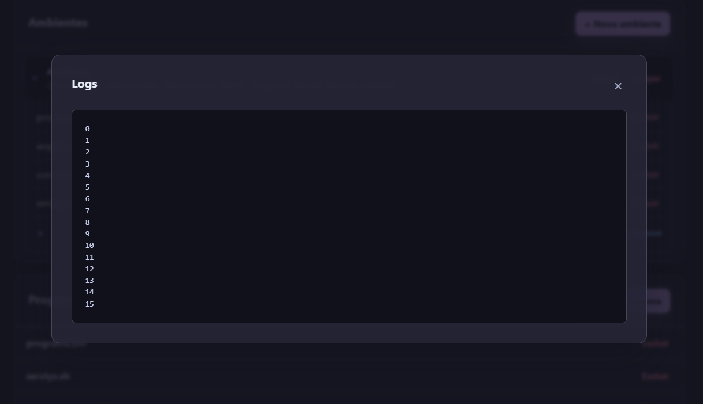
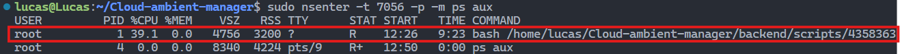

# Projeto de Computação em Nuvem: Cloud Ambient Manager
## Feito por:
Felipe Pires Leonardi - 23013506  
Lucas Camargo Teixeira - 23011315  
Lucas Henrique Meng - 23003677  

## Objetivos da aplicação
Um site de gerenciamento de ambientes com customização de especificações (como memória, prioridade), para a execução de programas, utilizando Cgroup v2 e namespace.

### Tela inicial:

### Visualização de logs:

### Isolamento de processos e recursos:

O comando inserido roda o comando `ps aux` dentro do namespace do processo especificado (serviço.sh), exibindo todos os outros processos que podem ser enxergados por aquele processo.
É possível perceber que:
- O processo isolado não enxerga outros processos do sistema operacional;
- O processo ativo (programa que estressa a CPU) está usando apenas 40% da CPU, pois este é o limite definido para o ambiente.

## Linguagens e frameworks de implementação
- Frontend: HTML, CSS, JavaScript, servidos via NGINX.
- Backend: FastAPI.
- Banco de Dados: MySQL.